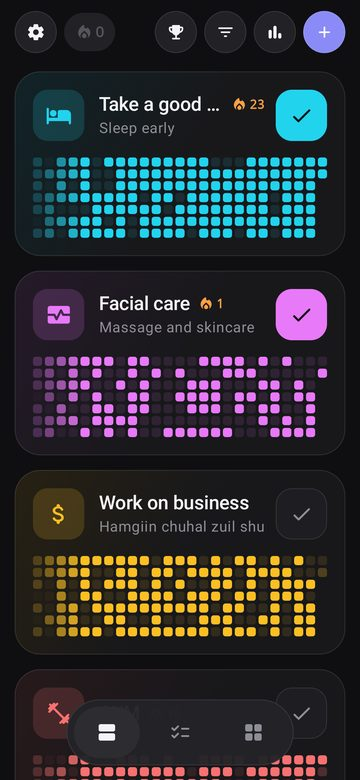
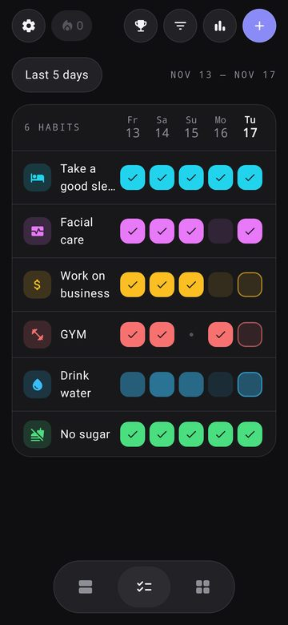
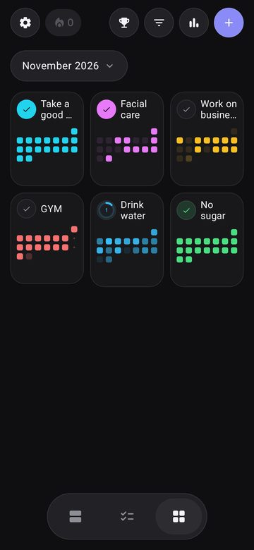
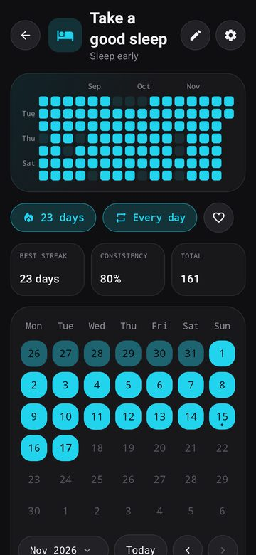
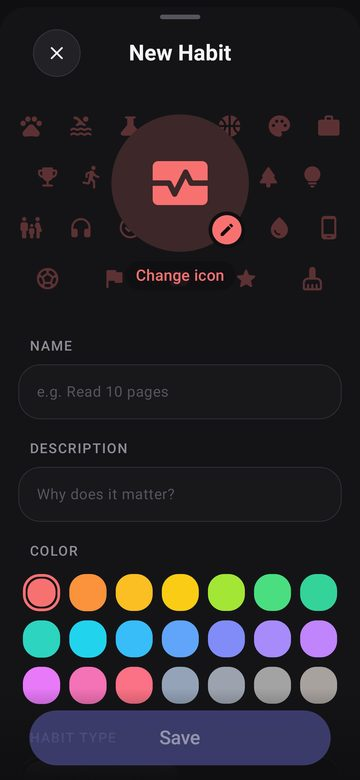
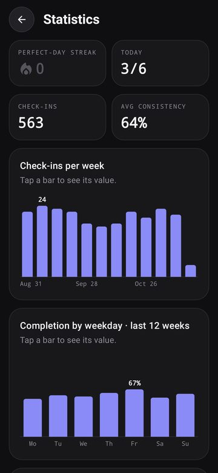
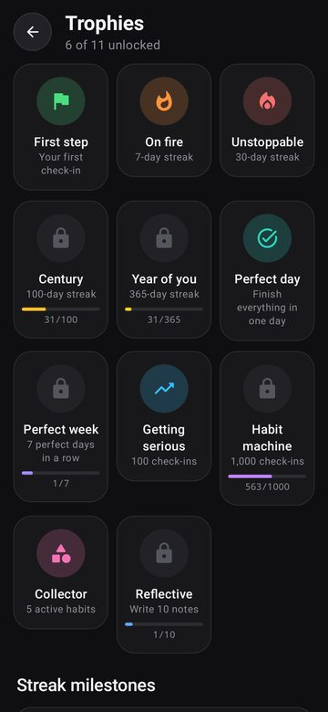
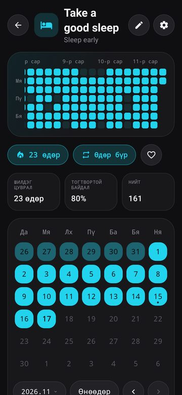

# Dadal: habit tracker with streaks

**Dadal** (Дадал, Mongolian for "habit") is an Android habit tracker. Its look is based on the
reference screenshots: dark cards, a GitHub-style heatmap per habit, and three home views. It adds
Duolingo-style streaks, alarm-style reminders, and a streak counter on the lock screen and home screen.

| Home | Last 5 days | Month | Habit |
|---|---|---|---|
|  |  |  |  |

| New habit | Stats | Trophies | Монгол |
|---|---|---|---|
|  |  |  |  |

## Features

**From the reference app**
- Three home views: big heatmap cards, a "last 5 days" table, and a compact month grid
- Categories (Fitness, Health, Finances to start with), icons, 21 colors
- Build or quit habits; Yes/No, Count (e.g. 8 glasses) or Measure (e.g. 30 min) tracking
- Repeat: every day, specific days, times a week, times a month, every few days
- Habit page with a year heatmap, calendar (tap to check, press and hold for a note) and notes

**Streaks and motivation**
- A streak per habit, plus an app-wide **perfect-day streak** 🔥 (every daily habit done), like Duolingo's
- **Milestone celebrations** with confetti at 3, 7, 14, 21, 30, 50, 100… days, and a "perfect day" celebration
- **Trophies**: 11 badges plus a 7/30/100/365 milestone ladder for every habit
- **Stats and insights**: check-ins per week, completion by weekday, your strongest and hardest day,
  most consistent habit

**Reminders**
- **Alarm style**: rings until you respond and opens a full-screen page over the lock screen, with
  Done / Snooze / Dismiss buttons. Or pick a normal notification.
- Up to 5 reminder times per habit. Reminders stay quiet when the habit is already done, paused or not needed today.
- **Streak-in-danger alerts**: an evening nudge (20:00 by default) only when a streak is about to
  break, and a last-chance alert at 22:30

**Lock screen, home screen, everywhere**
- **Lock-screen streak**: a quiet pinned notification with today's progress, your streak and a
  one-tap "✓ Done" for the next habit
- **Home-screen widgets**: "Today" (check habits off right on the home screen) and a streak flame
  that lights up once today is done
- **Quick Settings tile** and a quick check-in pop-up

**Practical**
- English and **Mongolian**, switchable in Settings → Language
- **Vacation / pause mode**: paused days never break a streak
- **Backup and restore** to a JSON file (Settings → Data)
- All data stays on the phone. No account, no internet needed.

## Install on your phone

1. Get the APK: open the latest run under **Actions → Build APK** on GitHub and download
   `dadal-apk`, or build it yourself (see below).
2. Open the APK on your phone and allow "Install unknown apps" when asked.
3. Open Dadal and allow notifications.
4. Go to **Settings → Reminder reliability** and make every row green. On Xiaomi / Redmi / POCO
   phones, also turn on **Autostart** and set battery to **No restrictions**. Otherwise MIUI/HyperOS
   can silence alarms.
5. Add widgets: long-press the home screen → Widgets → Dadal.

New APKs install over the old one and keep your data: every build is signed with the same key
(`app/debug.keystore`).

## Build it yourself

You need JDK 17+ and the Android SDK (Android Studio installs both).

```bash
./gradlew testDebugUnitTest   # streak logic tests
./gradlew assembleRelease     # → app/build/outputs/apk/release/app-release.apk
```

## Project layout

```
app/src/main/java/app/dadal/
  data/        Room database (habits, check-ins, notes, pauses, categories), settings, backup
  domain/      Streak, consistency, perfect-day and badge calculations (unit-tested)
  reminders/   Alarm scheduling, notifications, full-screen alarm page, lock-screen progress
  widget/      Home-screen widgets (Glance) and the Quick Settings tile
  ui/          Jetpack Compose screens: home, habit, new/edit, stats, trophies, settings
tools/generate_strings.py   English + Mongolian text; edit it, then run it to regenerate strings.xml
```

## Before publishing on Google Play

- Create your own private signing key and keep it out of the repository. The bundled key is fine
  for personal installs only.
- Alarm-style reminders use the `USE_EXACT_ALARM` and full-screen notification permissions. Google
  Play reviews apps that ask for these, so you will need to explain the alarm feature in the
  Play Console, or switch to `SCHEDULE_EXACT_ALARM`.
- Android phones don't allow third-party lock-screen widgets (only some tablets do). That is why
  the lock-screen streak is a pinned notification, the same approach Duolingo uses on Android.
